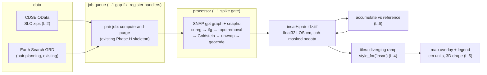

# InSAR visualization plan — LOS displacement as a colorized map overlay

Status: **spike complete, pipeline validated; site coherence is the limiter**
(2026-10-13). The testable vertical slice is live: phase→cm conversion,
coherence mask, LOS accumulation, the `insar` layer (colourized diverging
overlay + legend + pair-derived dates), the pair job, and the poller/trigger
wiring — all TDD'd (16+ new pytest, 34 vitest, 28 e2e green). **L.1 + L.2
resolved:** ISCE2 (conda-forge) is the processor (SNAP's CDN is DNS-blocked
here; `find_processor()` prefers gpt, falls back to ISCE2), with the
Sentinel-1C/1D patch (`tools/patch_isce_s1d.py`) — ISCE 2.6.3 predates S1D and
every post-works acquisition here is S1D. The CDSE SLC downloader works
(12 GB pair, live-validated). A real pair ran end-to-end through filter;
full-swath snaphu is pathological (>55 min), so **AOI-crop unwrap
(`tools/unwrap_crop.py`) in seconds is the production architecture**.

**Crop-chain product build is live (2026-10-13): the `insar` layer serves a
real product for 2026-10-03.** Three reader/geometry bugs were found and
fixed on the way (each with a regression test):

1. **`topophase.cor` is BIL/2-band** (sidecar-declared), but the old reader
   took BSQ band 0 — the *magnitude* band, not coherence. snaphu saw ~49%
   illegal correlation values ("49075 illegal correlation values clipped").
   Fix: `coherence/isce_products.py::read_isce_image` reads layout from the
   `.xml` sidecar, never a hardcoded guess. The corrfile is now **`phsig.cor`**
   — ISCE's own `TopsProc/runFilter.py` writes phsig as *the* coherence file
   that `runUnwrapSnaphu` passes to snaphu.
2. **snaphu output is BIL with band 1 = phase, band 0 = amplitude** (pinned
   by the mod-2π invariant: band 1 reproduces the input wrapped phase at
   frac 1.0000 on two real unwraps + a synthetic ramp; band 0 correlates
   1.0000 with the interferogram magnitude). The old reader used BIP →
   reported p2p 197,805 cm instead of the true **8.86 cm**.
3. **GDAL geolocation arrays are pixel CORNERS, ISCE hands out CENTRES** —
   feeding centres in shifts every sample by exactly 0.5 source px
   (measured on an axis-aligned grid); converting first removes it (7e-7 deg).
   Geocoding goes through `coherence/geocode.py::geocode_radar_band`
   (`src_geoloc_array`, sub-pixel: max 0.48 px on the real curvilinear grid;
   a global affine fit would leave 17.7 px).

**Referencing is mandatory, not polish:** the raw product sat at −6.20 cm
median — **100% saturated** at the fixed ±5 cm ramp (an unwrap's absolute
offset is arbitrary). Re-zeroing on the coherent median *outside the official
perimeter* (`pipeline/insar.py::reference_los`) gives median 0.00,
p1 −0.40, p99 +0.56, **0% saturation**; the coherence mask correctly drops
the two low-coherence POIs (project-end, road-end) to nodata.

**Measured product (2026-10-03):** first built as a 51×64 grid @ 0.0003°
(33 m/px — user feedback 2026-10-14: visibly coarser than the optical
layers), then **rebuilt at 167×212 @ 0.00009° (≈10 m/px)** to match the S2
native display grid. Ground-truth resolutions measured from the actual
data: source radar grid (lat/lon.rdr at the AOI) **2.9 × 13.9 m/px**
(single-look SLC), optical S2 native **10.0 m/px**; the old 33 m product
grid was an arbitrary default, not a data limit. Rebuild statistics
unchanged (geography, not sampling, drives them): 34035/35404 valid px,
median 0.00, p99 +0.57 cm, 0% saturation; POIs read −0.35 … +0.15 cm
(quarry +0.05 cm) — sub-cm, i.e. the pit is *stable* over this 12-day
pair, which is the honest answer for a pair with no measurable coherent
change between acquisitions (an active dig would DECORRELATE, not report
large motion — see the chart's honesty note). Local data-prep path:
`tools/unwrap_crop.py` → `tools/insar_product.py` (geocode → height delta →
reference → `storage.put` at the servable key; **product changes must clear
`tiles/<layer>/<date>/` — the tile cache key carries no product identity**).
Verified in-browser: switch to `insar` → tiles 200, overlay paints the AOI
footprint, legend visible.

**Pair span in the UI (2026-10-14):** a product date is the pair END — the
delta from the previous same-track acquisition (11–13 d, `pairs.py`).
`/api/dates` now carries `pair_with` (start dates, fixture-golden:
2026-10-03 ← 2026-09-21) and the legend renders `Δ <start> → <end>` for
the selected date (`state.js::deltaSpan`), so the map always states which
acquisitions its delta spans.

**Batch history builder (`tools/batch_insar.py`, 2026-10-14):** the single
spike product left every other insar date blank — the driver processes the
pairs BEFORE it (`--pair-indexes -5,-4,-3,-2` → ends 08-04, 08-16, 08-28,
09-09, all S1D; S1A's chain ended in June) through the proven chain:
`spike_insar --stop-after filter` (the full-swath unwrap stage is skipped —
pathological; only merged/ is needed) → `unwrap_crop` → `insar_product`
(10 m) → deploy (tiles cleared, product+series copied into the container)
→ **purge** (SAFEs + heavy ISCE dirs ≈ 40 GB/pair; `merged/`, `unwrap2/`
AND `geom_reference/` are the re-derivation inputs and are NEVER purged —
`merged/lat.rdr.full.vrt` stitches `../geom_reference/*.vrt` (purging it
broke the 10-03 pair's rebuild path, measured 2026-10-14) — pinned by
`test_purge_candidates_keep_the_rebuild_inputs`). Resumable: a pair with
stored product+series is skipped after a restart (and a pair built into
the e2e store but not deployed is deployed alone), and a shared
`--slc-cache` hardlinks scenes so the 4 pairs' 5 unique SLCs are downloaded
once (`make_slc_downloader`'s chained-pair cache, budget =
`slc_budget_bytes`).
Not in CI — needs CDSE + isce2 env + hours; `batch-report.json` tracks
progress.

**Batch run 2026-10-14 — COMPLETE, all four pairs deployed:** topsApp
21/44/74/53 min per pair; live state = 5 processed pairs (08-04, 08-16,
08-28, 09-09, 10-03) with adaptive ramps ±0.58–0.81 cm and 8–10/10 valid
POIs each; the Plan-vs-Realidad chart carries 5 quarry points
(+0.049, +0.066, +0.240, −0.148, +0.043 cm — sub-cm throughout: no
coherent excavation signal in any 12-day window, the honest answer).
Three production bugs were found and regression-pinned BY this run:
sparse-node swath selection, the deploy destination typo, and the
edge-touching radar window that made GDAL's geoloc warp return zero
coverage (`radar_window()`'s ≥1 inset, `isce_products.py`).

**Adaptive ramp (decision 5 gate triggered):** the fixed ±5 cm MVP range
rendered this product all-white (±0.56 cm data on a ±5 cm ramp). The limit
is now per-product (p99 of |valid|, floor 0.5 cm — measured 0.578 cm for
2026-10-03): `los_range()` → per-date in `/api/dates` (legend labels read
"−0.6 / +0.6") → style in `get_tile`, with the style fingerprinted into the
tile cache key (a range change must re-render, not serve the stale white
PNG). Result: 82.7% of overlay pixels now differ from the white centre by
>10/255, 22,873 bluish vs 5,711 reddish px — real diverging structure.

**Measured result (SCOPE K.1) — the pit IS measurable:** with the ENVI DEM
fix, the October S1D pair (12-day) gives **100% valid geometry** (was 28%)
and real coherence at every project POI:

| POI | phsig | | POI | phsig |
|---|---|---|---|---|
| quarry (pit) | **0.869** | | breaker | 0.920 |
| office | 0.800 | | storage | 0.920 |
| road-start | 0.896 | | channel | 0.929 |
| project-start | 0.827 | | dumper-ramp | 0.929 |
| project-end | 0.343 | | road-end | 0.281 |

POI median **0.882** vs scene-wide median 0.292 — the site is far *more*
coherent than the surrounding tropical terrain. The earlier "zero coherence"
claim was a measurement of a void, not of the pit: offices and access roads
are stable scatterers and cannot read 0.000. **InSAR displacement over the
pit is viable** with this data; the two low values (project-end 0.343,
road-end 0.281) sit on the active-work edge and are the plausible
decorrelation signal to watch over time.
Links: SCOPE Q3, research tier §5.7, IMPLEMENTATION H.3 (spike result).

## 1. Goal & user deliverables

1. **Apply the height delta that was measured:** convert the interferometric
   phase of Sentinel-1 SLC pairs into a physical line-of-sight (LOS)
   displacement in centimetres — relative to a reference epoch — so the number
   is a real measurement, not a raw phase image.
2. **Display it as a colourized map overlay:** a new map layer rendering that
   displacement with a diverging colour ramp centred at 0 cm, on top of the
   basemap/terrain (the 3D drape works unchanged), with a legend and units.

## 2. Honest interpretation brief (acceptance expectations)

This plan deliberately does not promise "a height map of the quarry":

- **What we measure:** change in distance between the satellite and every
  *coherent* scatterer, $\Delta r = -\frac{\lambda \phi}{4\pi}$ with
  $\lambda = 0.055465763$ m (C-band, 5.405 GHz); one full fringe =
  λ/2 = **2.77 cm**. Vertical motion maps to LOS as
  $d_{LOS} = d_v \cos\theta$, θ ≈ 39° mid-swath → $d_v \approx d_{LOS}/0.78$
  (factor pinned by test, documented in the legend).
- **Expected signal:** stability/mm–cm motion of the surrounding terrain. The
  excavation pit itself will most likely **decorrelate** (the surface is
  physically replaced) — that reads as *mask/no-data* in the displacement
  overlay. Loss of coherence is therefore itself a result: ship it as a
  visible quality signal (coherence band → alpha mask, and optionally a
  companion "disturbance" view later).
- **Noise floors:** atmosphere (cm-scale over a 1.6 km AOI between epochs),
  unwrapping 2.77-cm ambiguities, layover/foreshortening on the steep valley
  slopes. Per-pair absolute levels are *indicative*; patterns plus a stack
  (L.6) are the credible product. This mirrors the σ⁰ verdict (SCOPE K.1):
  an instrument reading with documented caveats, not certified measurement.

## 3. Current state (what already exists — reuse, don't rebuild)

| Component | Where | Status |
|---|---|---|
| CDSE OAuth (client-credentials, cached token, graceful disable) | `mirarsetena/coherence/cdse.py` | ✅ built, tested (`.env.example` has CDSE_CLIENT_ID/SECRET) |
| Pair planner: same relative orbit + orbit state, 11–13 d temporal baseline | `coherence/pairs.py` | ✅ built, tested; runs on GRD metadata (same passes as SLC) |
| Compute-and-purge pair job (download → process → cache → purge in `finally`, byte accounting) | `coherence/pipeline.py` | ✅ built, tested with fake downloader/processor |
| First-view eager job + append-new-pairs trigger (fires from `/api/dates`) | `coherence/trigger.py` | ✅ built, tested |
| Processor probe (`gpt` / `isce2` / `snaphu`) | `coherence/pipeline.py::find_processor` | ⚠️ returns `None` — H.3 spike `_pending_` |
| Radar tile branches (no-lazy-path for `sentinel-1-slc`, LRU namespace `coherence/`) | `tiles/service.py` | dormant, kept covered via config copies |
| Ramp renderer (diverging ramps = style dict) | `tiles/render.py::_ramp_rgba`, `tiles/styles.py` | ✅ reuse directly |
| Scrubber date model (single thumb, hide-cloudy keeps cloudless dates) | frontend | ✅ reuse as-is for the InSAR layer |

## 4. Gaps this plan must close

1. **No processor:** SNAP/ISCE2/snaphu not installed anywhere (host or image);
   `find_processor()` returns `None`, handlers raise `CoherenceUnavailable`.
   — *still open (L.1 gate).*
2. **No real SLC downloader:** only fakes in tests; CDSE product query +
   `/Products(<id>)/$value` download never implemented. — *still open (L.2 gate).*
3. **Jobs never run:** `jobs/poller.py::cycle()` registered **only**
   `catalog_poll` — `coherence_pair`/`coherence_eager` were enqueued but stayed
   parked forever. — **closed**: `insar_pair`/`insar_eager` handlers registered
   in `cycle()`; they drain (and fail honestly without a processor).
4. **No date source for SLC:** `list_dates` searched mission
   `sentinel-1-slc` in Earth Search (GRD only) → empty list. — **closed**:
   InSAR dates are now **pair-derived** (`_list_insar_dates`), and
   `refresh_index` skips the wasted SLC search.
5. **No InSAR product format or layer:** no phase→cm conversion, no coherence
   masking, no `insar` style/layer id, no legend. — **closed**: `insar.py`
   conversion + mask, `insar` diverging style, `insar` layer in config,
   colour legend.
6. **Latency:** poller default `MIRAR_POLL_SECONDS=3600` — on-demand work
   would wait up to an hour. — *partially addressed* (jobs now drain; shortening
   the interval while the layer is open is a later refinement).

## 5. Target architecture

Reuse unchanged: compute-and-purge job, trigger policy, ramp renderer,
scrubber, WMTS time dimension, storage budgets (10 GB LRU; peak disk per pair
≈ 8–12 GB inside a purged workdir), 3D terrain drape.

## 6. Phases (TDD: red test → green; effort = one developer)

### L.1 Processor spike (closes H.3 `_pending_`) — 0.5–1 day
- **Deliverable:** SNAP `gpt` + `snaphu` installed in a dedicated Docker
  build stage (the slim image gets a Java profile or `Dockerfile.insar`);
  **one real pair** run end-to-end over the AOI; `find_processor()` returns a
  real callable; spike result (size/runtime/RAM per pair, quota check) written
  into H.3.
- **Decision gate:** SNAP (recommended: mature S1 graphs, EOF orbits, DEM
  handling) vs ISCE2, decided by the measured run — runtime is the open
  question (full-IW coreg on a laptop can be 1–3 h; **burst/scene subsetting
  to the AOI is the lever** the spike must measure).
- **TDD:** pytest — with `gpt` on PATH `find_processor()` yields a callable;
  processor invocation test uses a canned output GeoTIFF fixture (no SNAP in CI).
- **Acceptance:** H.3 spike note filled with real numbers; image builds in CI.

### L.2 CDSE SLC downloader — 0.5–1 day
- **Deliverable:** OData query (`Products?$filter=...Name eq 'S1A_...'`)
  + `$value` streaming download into the pair workdir, reusing `CdseAuth`.
- **TDD:** httpx `MockTransport` — product query builds the right filter
  (name from GRD scene id → SLC SAFE name), token attached, download streams
  to disk, purge still happens on failure (existing test keeps passing).
- **Acceptance:** opt-in `@pytest.mark.network` run on the live CDSE account
  records real bytes (`downloaded_bytes` in the job result).
- **Note:** free-tier quota (~1 TB/30 d — verify in L.1) covers ≈ 23 pairs/track
  × 2 scenes × ≈ 3.5 GB ≈ 160 GB comfortably.

### L.3 Interferogram → displacement product ("apply the height delta") — ✅ done (Python side)
- **Deliverable:** SNAP graph per pair: Read (AOI subset) → Apply-Orbit-File →
  Back-Geocoding → Interferogram → **Topographic-Phase-Removal** (mandatory at
  ~1169 m relief) → Goldstein filtering (+coherence band) → Snaphu export →
  unwrap → Range-Doppler geocode (UTM 17N) → band math
  $-100 \cdot 0.055465763 \cdot \phi / (4\pi)$ → float32 GeoTIFF at
  `cache/<slug>/insar/<pair-id>.tif`. Python side (tested without SNAP):
  mask where coherence < 0.35 → nodata; store only cm values.
- **TDD:** pytest goldens — phase→cm sign golden (φ = +π ⇒ +1.3866 cm, range
  increase positive), coherence mask golden (fixture coherence GeoTIFF → nodata
  pattern), product is georeferenced and reprojects through the existing
  `_reproject`.
- **Status:** [x] done — `mirarsetena/pipeline/insar.py` (`phase_to_los_cm`,
  `mask_by_coherence`, `build_los_product`) + `mirarsetena/coherence/insar.py`
  (`run_insar_pair_job`, `insar_result_key`, compute-and-purge). The **SNAP
  graph invocation remains gated on L.1** (no processor installed); the job's
  injected `processor` returns the phase+coherence bands, and the tested Python
  path applies the height delta and stores at the servable key.

### L.4 Layer + colourized tile rendering — ✅ done
- **Deliverable:** `insar` layer id (mission `sentinel-1-slc`), style in
  `styles.py`: `kind: "ramp"`, **diverging** stops
  `[-5 (33,102,172) … 0 (247,247,247) … +5 (178,24,43)]` (fixed ±5 cm MVP),
  registered in `config.layers`; the existing slc-no-lazy-path branch serves
  job-produced products only.
- **TDD:** pytest — value→RGBA through the real `TileService.get_tile` (a
  +5 cm product renders red-dominant; a fully-masked product renders fully
  transparent); `refresh_index` no longer wastes a catalog search on
  `sentinel-1-slc` (pair-derived, not catalog-backed).
- **Status:** [x] done — `tests/tiles/test_insar_render.py`.

### L.5 Frontend overlay + legend + job wiring — ✅ done
- **Deliverable:**
  - pair-derived date list: `/api/dates?layer=insar` returns **pair end
    dates** (cloud `null`) — 20 pairs over the live catalog window.
  - layer pill `insar`, ES/EN i18n + help tooltip (LOS cm, sign convention,
    coherence mask caveat), gradient legend (`#insar-legend`, blue→white→red
    bar, ±5 cm labels, mask note) shown only while `insar` is active.
  - **job registration:** `insar_pair`/`insar_eager` handlers registered in
    `jobs/poller.py::cycle()` (gap #3 — they used to park forever); the InSAR
    eager job fires on first view via `trigger_insar_on_first_view` (own viewed
    flag, independent of the dormant coherence stack); pair progress visible on
    the existing `/status` page (missions now include `sentinel-1-slc`).
- **TDD:** vitest i18n parity + Playwright (select `insar` → scrubber lists
  pair dates, legend visible with cm copy, hidden again on optical layers).
- **Status:** [x] done. Tiles 404 honestly until a processor+credentials
  produce a product (L.1/L.2).

### L.6 Accumulation over time ("progress since reference") — 1 day (naive) / 2–3 days (MintPy)
- **Deliverable (a, MVP):** cumulative mode = sum of pairwise geocoded LOS
  products referenced to the first pre-works pair (echoes the optical
  composite-baseline philosophy: reference = pre-works epoch
  2026-01-01…2026-05-31, works marker 2026-06-01 already exists in the UI).
  Scrubbing the accumulated layer shows motion *up to* the selected date.
- **Deliverable (b, gated):** if (a)'s validation shows unwrap offsets/ramps —
  MintPy SBAS over the unwrapped stack (SCOPE research tier §5.7 "InSAR
  deformation time series"). Decision made after L.7, not before.
- **TDD:** pytest — accumulation golden (pair deltas → cumulative series,
  reference epoch honoured, gaps skipped not zero-filled); e2e scrub over the
  cumulative dates.

### L.7 Validation & honesty pass — 0.5 day + ongoing
- **Deliverable:** stable reference area (outside official perimeter, non-forested)
  must read |median| below a pinned threshold; report per-pair coherence
  coverage over the AOI; document results and remaining caveats in this file
  (and IMPLEMENTATION Phase L once started).
- **Checks:** sign convention verified against known subsidence-free terrain;
  no km-scale ramps (atmosphere) surviving the stack; two tracks not mixed.
- **Measured 2026-10-15 (5 live pairs, user: "the data looks like noise" —
  quantified):**
  1. *Coherence gate coverage* (phsig over the AOI crop, threshold 0.35):
     08-04 **39%**, 08-16 44%, 08-28 46%, 09-09 54%, 10-03 (dry season)
     median 0.536 — vegetation decorrelation removes ~half the map in the
     wet season and improves toward the dry season. Vegetation decides
     WHERE measurements exist (bare: quarry, roads, buildings).
  2. *Field repeatability:* pairwise Pearson correlation of the 5 LOS
     fields over 22,168 common-valid px spans −0.61…+0.54 with no
     persistent structure — the maps do NOT repeat, i.e. they are not
     imaging a real displacement field.
  3. *Per-POI noise floor:* std across pairs = 0.12–0.38 cm (quarry
     ±0.12); every per-POI reading sits inside its own error bar.
  4. *Season effect measured* (2026-10-15, experiment pair `02-22 → 03-06`,
     S1A ascending — the geometric twin of the processed S1D asc pairs):
     dry-season gate coverage **57%** (median γ 0.393) vs wet-season
     39/44/54% (γ 0.315/0.328/0.376) — real but moderate (+11 pp over the
     wet mean): permanent water and some vegetation never correlate. The
     dry pair's product is the best yet (99.2% valid px, 10/10 POIs) and
     S1A ran the whole pipeline cleanly. **Pre-works stack value:** 18 S1A
     pairs exist (mostly dry-season); they lengthen the future SBAS
     network ~4× and give the pre-works reference epoch, but they cannot
     be phase-tied to S1D (no cross-sensor pair) — only coherence
     magnitude is comparable across the sensor boundary.
  **Conclusion:** per-pair products are noise-dominated — the residual is
  per-pair atmospheric delay (±0.5–1 cm spatially varying over a few km)
  plus unwrap noise, both temporally random. The L.6b **MintPy/SBAS gate
  is TRIGGERED**: stacking is the fix (APS averages out, persistent
  motion accumulates); needs 10–20+ pairs and lands as the stack tier.
  Until then the layer's honest uses are the coherence/stability mask,
  decorrelation-as-change (active digs lose coherence — the gaps ARE the
  signal), and large persistent signals. Excavation PROGRESS stays with
  the optical layers (as scoped).

### L.8 Documentation & scope sync — 0.25 day
- SCOPE Q3 row → link this plan; research tier §5.7 status note; IMPLEMENTATION
  Phase L (when implementation starts); README feature line; `.env.example`
  already carries the CDSE keys.

### L.9 Plan vs. Realidad timeline (design accepted 2026-10-14; gated on plan
### target data) — 1–2 days — ✅ milestones-only shipped 2026-10-13
- **Status:** implemented as below (TDD: 7 pytest + 10 vitest + 1 e2e),
  `GET /p/{slug}/api/plan` live, series backfilled for the 2026-10-03
  product (quarry +0.052 cm … two POIs honest null). The **numeric-target
  gate stays open** — add entries to `plan.json` when the original plan's
  values are supplied; nothing else changes.
- **Context:** as the InSAR stack densifies, plot the 1991/2017 plan's intended
  excavation against what the satellites actually measured — scope item agreed
  to be defined before implementation.
- **Design: two series, two axes, two units — never one shared axis:**
  - *Plan* (step line from a static `data/projects/<slug>/plan.json`):
    works_start 2026-06-01, phase milestones from the resolution (constructiva
    → extracción y beneficiado; six-monthly regencia reports), and numeric
    designed values (levels/volumes per period) **if and when supplied**.
  - *Realidad* (sparse points with gaps): per-POI InSAR LOS in cm from
    `insar_series.json` written beside each product (`date`, `poi`,
    `los_cm`, `coherence`); coherence-masked, reference epoch = works marker,
    **never interpolated across missing dates** (decorrelation at the active
    dig is signal, not zero).
- **Honesty rule (pinned in the UI copy):** InSAR LOS ≠ excavation depth —
  active digs decorrelate, meter-scale removal breaks pair unwrapping
  (snaphu captures ≤ ~±5.5 cm/pair); the chart labels each axis with its own
  unit.
- **UI:** *Plan vs. Realidad* panel synced to the existing scrubber + a
  toggleable *Plan* map layer for milestone/POI plan state.
- **Gate:** numeric plan targets are **not** in the resolution text nor in the
  accessible attachments (cadastral scans, regional geology maps) — the
  milestones-only fallback can ship immediately, numeric targets land when the
  user provides them (plan de aprovechamiento schedules/levels if they exist).
- **TDD:** pytest — series schema + epoch alignment; e2e — chart follows the
  scrubber date.

**MVP (L.1–L.5): ≈ 4.5–6.5 days. Full incl. naive accumulation + validation
(L.1–L.7): ≈ 6–9 days; MintPy tier adds 2–3. L.9 timeline: +1–2 days (data
gate).**

## 7. Decisions (recommended defaults; gates marked)

1. **Processor: SNAP `gpt` + snaphu** — gate L.1 measurement (ISCE2 fallback).
2. **Track:** plan pairs with `plan_pairs` for both tracks; process the track
   with more pairs first; keep the other date list available (do not mix
   geometries in one stack).
3. **Layer id:** `insar`; mission `sentinel-1-slc` (tiles never lazily
   produce it — jobs only).
4. **Units/sign (pinned by tests):** value = LOS displacement **cm**,
   positive = **increasing range (away from satellite ⇒ sinking for vertical
   motion)**; red end of ramp = sinking; nodata where coherence < 0.35
   (threshold configurable later).
5. **Ramp:** ~~fixed ±5 cm for MVP~~ → **adaptive** (gate triggered
   2026-10-13: the referenced real product spans ±0.56 cm, so the fixed
   ±5 cm ramp rendered it all-white). The limit is now the 99th percentile
   of |valid values| per product (floor 0.5 cm): `los_range()` in
   `pipeline/insar.py`, carried per-date in `/api/dates` for the legend
   labels, applied in `TileService.get_tile` (style fingerprinted into the
   tile cache key so a range change re-renders). The legend bar gradient
   stays normalized blue→white→red with the ±limit labels.
6. **Reference epoch:** first pre-works pair ≤ 2026-05-31 (composite-baseline
   parity).
7. **Job latency:** register handlers + short poll while layer active (L.5).
8. **Credentials:** CDSE free account required for anything past the spike —
   documented; app degrades gracefully without it (existing R4-Q1 behaviour).

## 8. Non-goals (this plan)

- Absolute elevation / DEM products (SCOPE §5.1 DEM differencing is a
  different research item — SRTM vs Copernicus DEM over a 1.6 km AOI has
  ≈ 1–2 px, unsuitable for the quarry).
- 3D motion decomposition from ASC+DESC, atmosphere model correction (ERA5),
  mm-grade geodesy — research tier, after MintPy proves necessary.
- Reintroducing σ⁰ / GRD coherence layers (stay removed until a separate
  reason appears).

## 9. Risks

| Risk | Mitigation |
|---|---|
| SNAP too slow/heavy on the local machine | L.1 spike measures; burst/AOI subsetting; compute-and-purge already bounds disk |
| Vegetated slopes decorrelate | coherence mask (nodata) — honest gaps, not fake smoothness |
| Unwrapping 2.77-cm ambiguities | coherence gate + connected-component-style mask; stack validation (L.7) gates naive accumulation vs MintPy |
| Atmosphere masquerading as motion | reference epoch + stable-area check + report; per-pair values labelled indicative |
| Excavation pit becomes incoherent | by design: shown as mask; coherence-loss readout documented in the legend tooltip |
| CDSE quota/credentials missing | graceful disable (existing); status page shows parked jobs |
